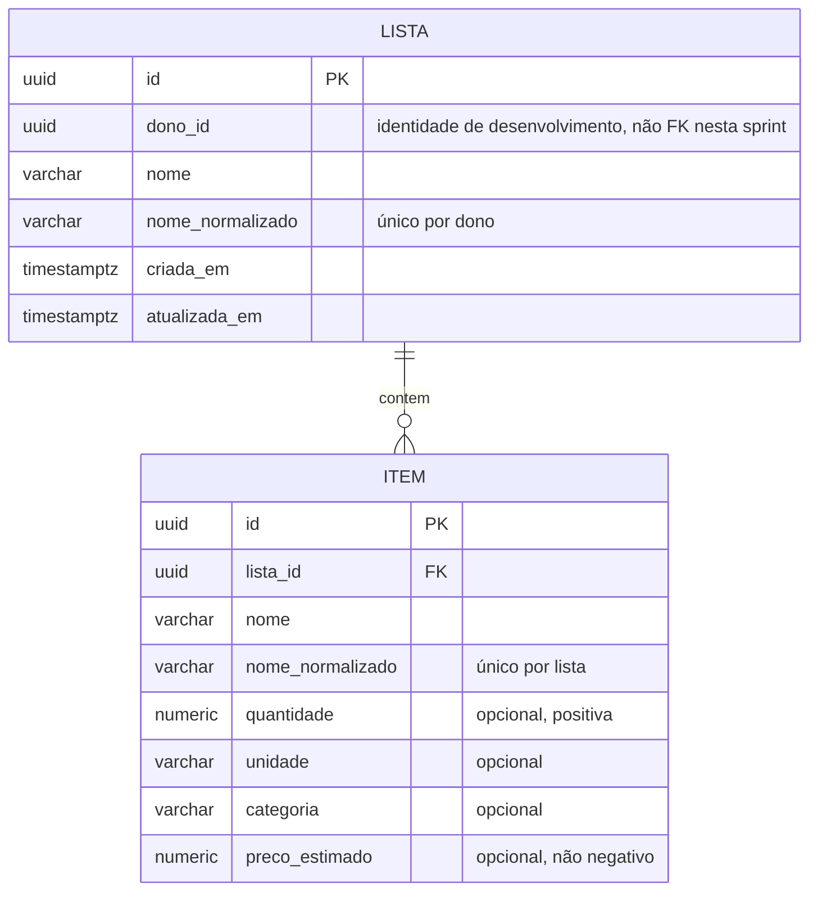
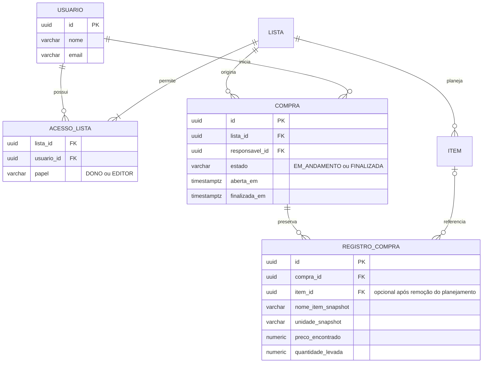

# Domínio e persistência — Sprint 1

## Implementado nesta sprint

Lista tem exatamente um dono, representado por UUID. A Sprint 1 usa uma identidade
fixa de desenvolvimento configurada **no servidor**, não recebida do cliente.
Isso não implementa autenticação. O modo é desabilitado fora do perfil `dev`, a
menos que seja explicitamente habilitado em ambiente confiável.

Migrações novas criam `lista` e `item`, sem alterar `V1__initProdutos.sql`.
`ON DELETE CASCADE` remove o planejamento da lista. A entidade JPA `Produto` e
sua tabela são legado: permanecem intactas e não representam um catálogo novo.
O CRUD novo usa UUID e `/api/v1/listas`; `/produtos` permanece fora do contrato MVP.

## Modelo planejado (não implementado na Sprint 1)

Regras futuras: um acesso DONO por lista; somente uma Compra EM_ANDAMENTO por
lista; RegistroCompra preserva nome/unidade, preço e quantidade históricos sem
depender da existência ou dos valores atuais de Item. A exclusão do planejamento
não deve apagar compras finalizadas. Quando compras forem implementadas, a
política de exclusão da lista deverá evoluir para preservar esse histórico.

Autenticação e compartilhamento substituirão a identidade de desenvolvimento.
Não existem tabelas de usuário, acesso ou compra nesta sprint: não apresentar
esses relacionamentos como persistidos, nem retornar progresso de compra fictício.
